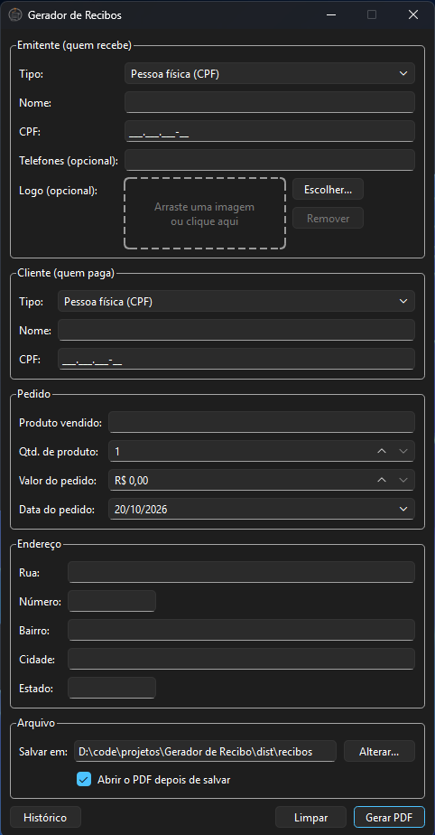
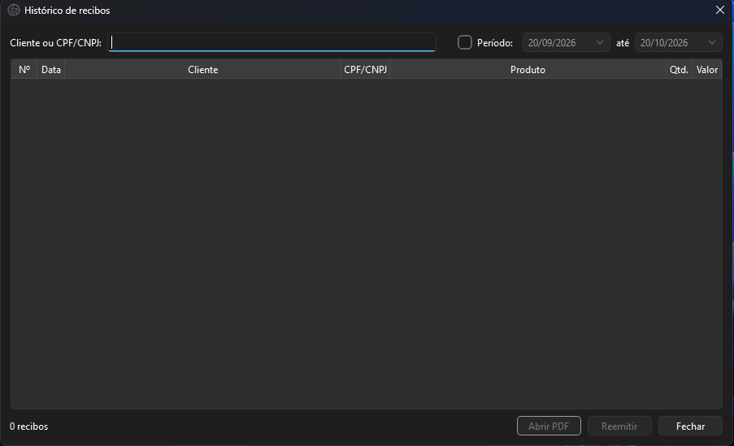

# 🧾 GeraRecibo

Em vez de editar o recibo na mão toda vez, você abre uma janela, preenche os
dados do pedido e o programa gera o PDF pronto para imprimir ou enviar pelo
WhatsApp.

Serve para qualquer produto ou serviço, e para emitentes e clientes
**pessoa física (CPF)** ou **empresa (CNPJ)**.

---

## ✨ Funcionalidades

- Formulário com **emitente**, **cliente**, **pedido** e **endereço**
- **CPF e CNPJ** com máscara e validação dos dígitos
  - Aceita o novo **CNPJ alfanumérico**
- Valor e quantidade **por extenso** automaticamente
  > Ex.: `R$ 50,00` → *cinquenta reais* · `5` → *cinco unidades*
- **Logo** do emitente (arrastar a imagem ou escolher o arquivo)
- **Pré-visualização** antes de salvar
- **Numeração sequencial** dos recibos (`Nº 0001`, `0002`…)
- **Histórico** com busca por cliente, CPF/CNPJ ou período
- **Reemitir** um recibo antigo com o mesmo número
- **Autocompletar** clientes já cadastrados
- Escolha da **pasta** onde salvar e opção de **abrir o PDF** após gerar

---

## ⬇️ Download

  

> ⚠️ Não coloque o `.exe` em `C:\Arquivos de Programas`:
> o app precisa gravar os recibos e o histórico ao lado dele.

> Se o Windows mostrar um aviso do SmartScreen, clique em
> **Mais informações → Executar assim mesmo**.

---

## 🛠️ Stack

- **Python** 3.11+
- **PySide6** — interface gráfica e pré-visualização (QtPdf)
- **ReportLab** — geração do PDF
- **num2words** — valores por extenso
- **SQLite** — histórico de recibos
- **PyInstaller** — empacotamento em `.exe`

---

## Screenshots

